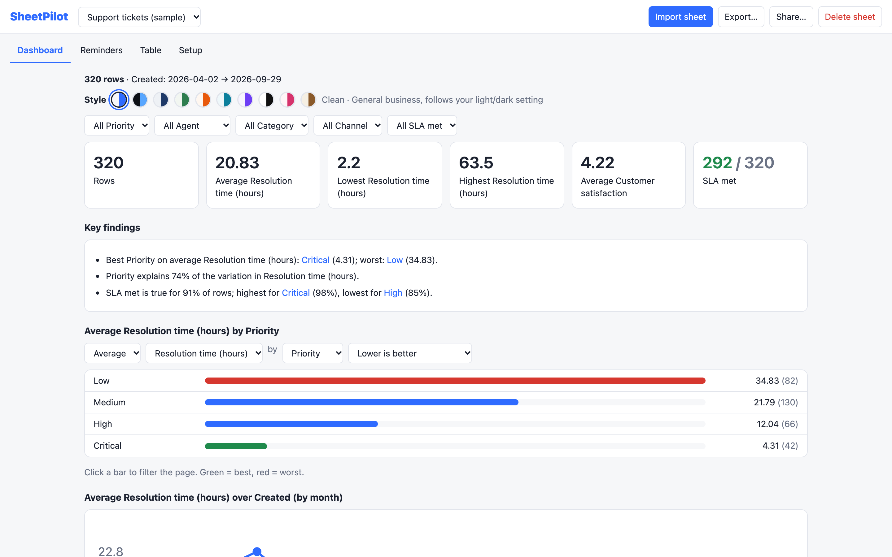

# SheetPilot

**Turn any spreadsheet into an interactive dashboard, in your browser.** Drop in a CSV or Excel file. SheetPilot works out what is in it, how it is calculated and what stands out, then builds the dashboard. Nothing is uploaded, and there is no account.



**Live app and website:** https://george-stathopoulos.github.io/sheetpilot/ ・ [Open the app](https://george-stathopoulos.github.io/sheetpilot/app/) ・ [Help center](docs/README.md)

## What it does

- **Reads messy sheets:** finds the real header row, merges repeated headers with their labels, handles semicolon and tab separated files, several Excel tabs, and ambiguous dates.
- **Finds the logic:** shows your real Excel formulas in plain words, or infers sums, products and ratios from the values, and flags rows that break them.
- **Chooses sensibly, and says so:** the main number, total or average, which direction is good, what to compare and the timeline. A "How I read your sheet" box lets you correct any choice, and corrections are remembered.
- **Writes findings in plain language,** including when nothing stands out, plus data checks.
- **Ten styles:** Clean, Midnight, Corporate, Forest, Sunset, Ocean, Violet, Mono, Rose and Paper.
- **Export** a self-contained web page, a PDF or the filtered rows as CSV, choosing which sections to include.
- **Share** a view-only snapshot or an interactive copy as a link. There is no server; the link carries the data.
- **Reminders:** optional, from date columns, for sheets that track follow-ups or reviews.

## Privacy

Everything runs in your browser. Files are read on your device and kept only in your browser's storage. The app has no analytics, cookies or ads. See [Privacy and security](docs/privacy-and-security.md).

## Documentation

The full guides, with screenshots, are in [docs/](docs/README.md) and on the website:
[Getting started](docs/getting-started.md) ・ [How it reads your sheet](docs/how-it-reads-your-sheet.md) ・ [The dashboard](docs/the-dashboard.md) ・ [Export and share](docs/export-and-share.md) ・ [Reminders and the table](docs/reminders-and-table.md) ・ [Messy sheets](docs/messy-sheets.md) ・ [Privacy and security](docs/privacy-and-security.md) ・ [FAQ](docs/faq.md)

## Run it locally

It is a static site with no build step:

```bash
python3 -m http.server 8000
```

Open http://localhost:8000. The Excel reader is loaded from a CDN the first time you import an Excel file; CSV works offline.

## Development

```bash
npm install
node dev/screenshots.mjs   # regenerate docs/images from the built-in sample sheets
node dev/og.mjs            # regenerate the social image
node website/build.mjs     # build the website into website/dist
```

## By

Made by [George Stathopoulos](https://george-stathopoulos.github.io/) (CV, projects and contact there). More projects: [Gatehouse](https://george-stathopoulos.github.io/gatehouse/) ・ [Helpdesk Hero](https://george-stathopoulos.github.io/helpdesk-hero/) ・ [Fixpass](https://george-stathopoulos.github.io/fixpass/)
