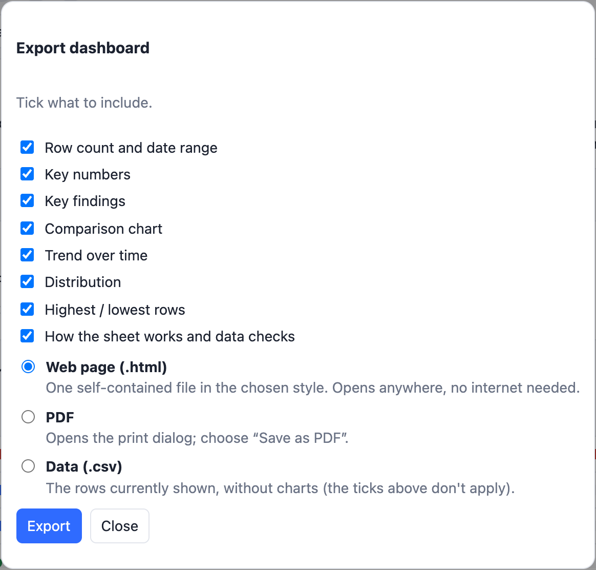
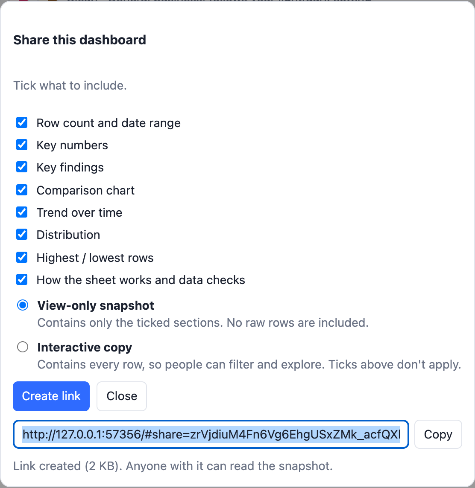
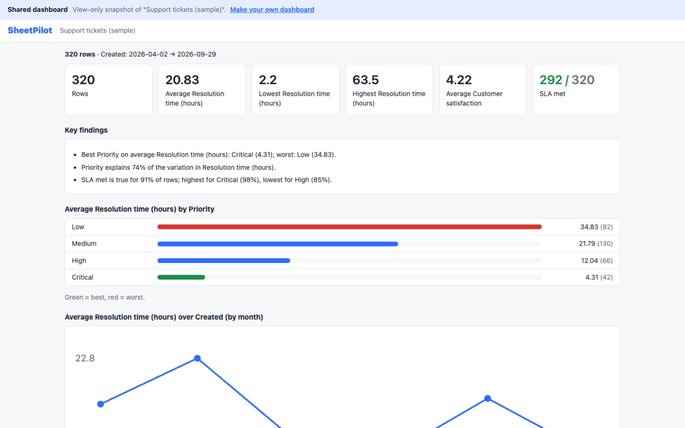

# Export and share

Both start from the dashboard you are looking at, including your current filters and style.

## Export

Click **Export…**, tick the sections to include, and choose a format:

| Format | What you get |
|---|---|
| **Web page (.html)** | One self-contained file in your chosen style. It opens in any browser, without internet, and keeps its charts and findings. Controls are removed. |
| **PDF** | Opens the print dialog in a new tab. Choose **Save as PDF**. |
| **Data (.csv)** | The rows currently shown, without charts. The section ticks do not apply. |

If you applied a filter, the export says so at the top, so nobody mistakes a partial view for the whole sheet. Every export carries a credits footer.

## Share

Click **Share…**, choose what to include, and create a link:

- **View-only snapshot**: contains only the ticked sections, as they look now. No raw rows are included. Opening it shows the dashboard without any controls.
- **Interactive copy**: contains every row, so the recipient can filter, compare and change the style. They can save a copy to their own sheets. Their changes are never sent back to you.

### How sharing works

There is no server. The link itself holds the data, compressed, after the `#` in the address, and that part of a web address is never sent to the web server. This keeps SheetPilot free and private, and it means:

- **Anyone who has the link can read what is in it.** Do not share confidential sheets this way, and note that chat apps and email systems may keep a copy of the link.
- **Links cannot be revoked or updated.** Create a new one if something changes.
- **Long links** (over about 30 KB) can be cut off by some chat apps. Large sheets may be too big for a link, in which case SheetPilot suggests exporting a web page instead.
- Snapshots open in a sandbox with scripts switched off, so a shared link cannot run code on your computer.

Next: [Privacy and security](privacy-and-security.md).
