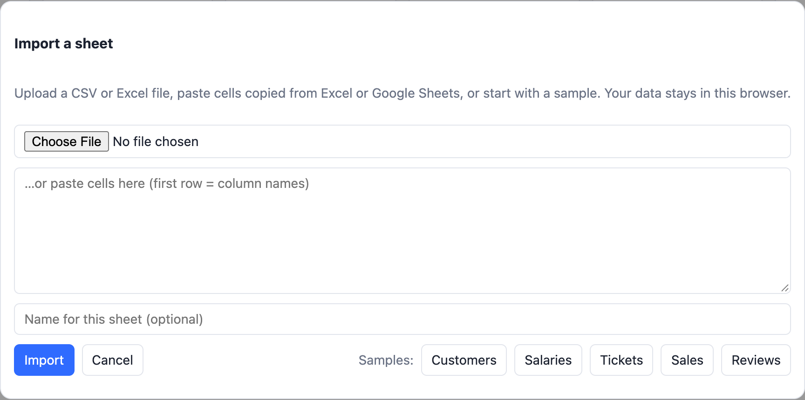

# Getting started

SheetPilot turns a spreadsheet into an interactive dashboard in your browser. There is nothing to install, no account to create, and your file is never uploaded.

## Open your first sheet

1. Open SheetPilot and click **Import sheet**.
2. Choose a file (CSV or Excel), or paste cells copied from Excel or Google Sheets. No file to hand? Click one of the samples: **Tickets**, **Sales**, **Reviews**, **Customers** or **Salaries**.
3. Click **Import**.

You land on the **Dashboard** tab, with a short box at the top: *How I read your sheet*. Check it looks right and click **Looks right**, or click **Adjust** to change anything. See [How SheetPilot reads your sheet](how-it-reads-your-sheet.md).

## What you get

- **Key numbers** and **findings** in plain language.
- A **comparison chart** (for example, average resolution time by priority). Click a bar to filter everything.
- A **trend** over time, a **distribution**, and a list of the rows that need attention.
- A **heatmap** when the sheet has scored criteria.
- A **How the sheet works** section with the formulas and data checks.

## The four tabs

| Tab | What it is for |
|---|---|
| **Dashboard** | The overview. Pick a style, filter, compare, export and share. |
| **Reminders** | Dates that need attention, if your sheet has follow-up or review dates. See [Reminders and the table](reminders-and-table.md). |
| **Table** | Your rows, editable, with search and sorting. |
| **Setup** | Change how the sheet is read, and the type of each column. |

## Your sheets are saved in your browser

Imported sheets are kept in your browser's storage on this computer, so they are still there next time. They are not synced between devices. Use **Export** to keep a copy (see [Export and share](export-and-share.md)), and note that clearing your browser's site data removes them.

Next: [How SheetPilot reads your sheet](how-it-reads-your-sheet.md).
