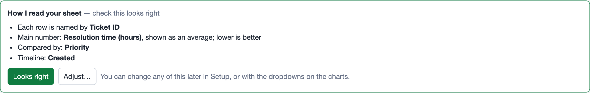
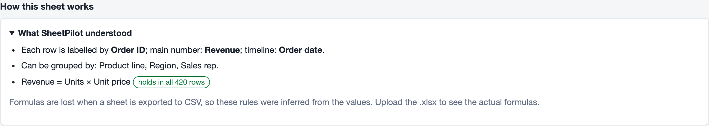

# How SheetPilot reads your sheet

Nothing needs to be set up. SheetPilot looks at the column names, the values and the relationships between columns, and makes a series of choices. It always tells you what it chose, and you can change any of it.

## The "How I read your sheet" box

After an import, the top of the dashboard shows what SheetPilot decided:

- **Each row is named by** a column such as *Name* or *Ticket ID*, used in lists.
- **Main number**: the measure the dashboard is built around, shown as a **total** or an **average**.
- **Which direction is good**: hours, cost and churn are *lower is better*; scores, revenue and ratings are *higher is better*; anything else has no good or bad direction.
- **Compared by**: the column that best explains differences in the main number.
- **Timeline**: the date column that works as a timeline (*Created* rather than *Hire date*).

A yellow **unsure** tag means the top two candidates were close. Click **Looks right** to dismiss the box, or **Adjust** to change things.

## How the choices are made

| Choice | How it is decided |
|---|---|
| Main number | Numeric columns are scored by their name (score, revenue, salary, hours…), their type (percent, money) and how many rows are filled in. ID-like numbers are ignored. |
| Total or average | Revenue, budget, cost and quantity columns are added up. Salary, price, time and score columns are averaged. |
| Direction | Names such as *time*, *hours*, *cost*, *churn* or *error* mean lower is better. *Score*, *revenue*, *rating* or *satisfaction* mean higher is better. |
| Compared by | For every candidate column, SheetPilot measures how much of the variation in the main number is explained by the groups. The highest wins. |
| Timeline | Event dates (*created*, *order date*, *start*) are preferred over attributes (*hire date*, *due*, *actual end*). |

The name rules are written for English column names. With other languages, SheetPilot falls back to *average* and *no direction* and flags what it is unsure about.

## Changing the choices

There are three ways, and your changes are remembered for that sheet:

- The dropdowns above the comparison chart: *average or total*, *measure*, *compared by* and *direction*.
- **Setup → How SheetPilot reads this sheet**, with an **Auto** option for each choice and **Reset to automatic**.
- **Setup → Column types**, if a column was read as the wrong type (for example text instead of a date).

## Formulas and logic

SheetPilot also works out how columns are calculated from each other.

- With an **Excel file**, it shows your real formulas in plain words, using column names instead of cell references: `=SUM([Quality of work]:[Customer focus])`.
- With a **CSV** (which keeps values but not formulas), it infers rules from the numbers: sums, products, ratios and copies. For example *Revenue = Units × Unit price*, with a note of whether it holds in every row.

> **For the best results, upload the Excel (.xlsx) file.** Inference can only guess; the real formulas are exact, and they also explain special cases such as "N/A counts as 5".

Rows that break a rule are listed, so you can spot typos and mistakes. Columns that are the sum of a set of columns, such as scores, drive the **heatmap**.

## Findings and data checks

The **Key findings** box writes a few sentences about what stands out: the biggest group, the best and worst group, how much a column explains, trends, and extreme outliers. When nothing stands out, it says so. The data checks list empty columns, entries such as "N/A" in number columns, and repeated IDs.

Next: [The dashboard](the-dashboard.md).
