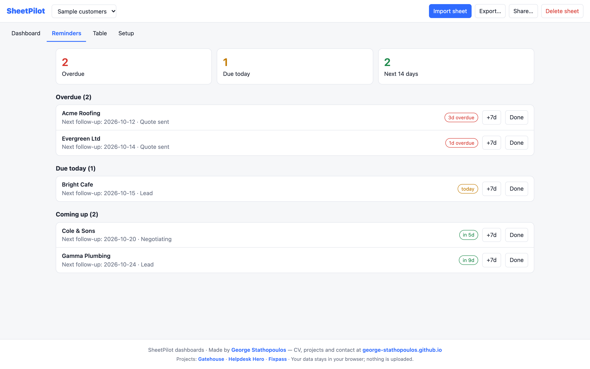
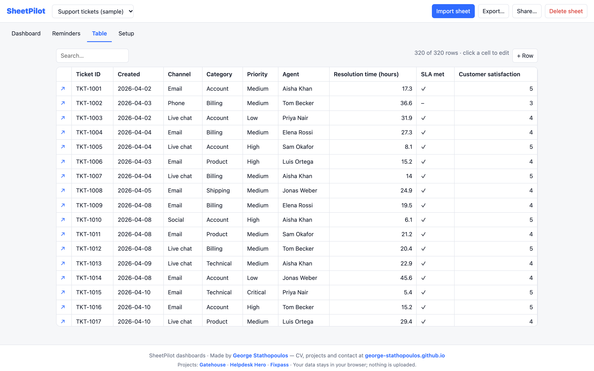
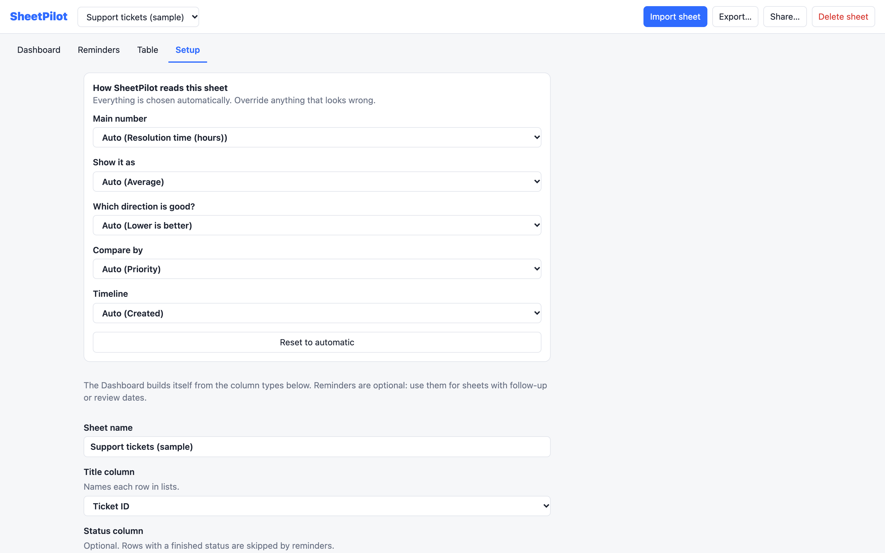

# Reminders and the table

Some sheets are not only for reporting: they also track things that need doing. SheetPilot can turn date columns into reminders.

## Reminders

Open **Setup → Dates that trigger reminders** and tick the date columns that matter, such as *Next follow-up* or *Review date*. Use the **offset** to shift the reminder: `3` is three days after the date, `-30` is thirty days before it (useful for contract end dates).

The **Reminders** tab then lists what is overdue, due today and coming up in the next 14 days. For each item you can:

- **+7d** to move the date a week later, or
- **Done** to clear the reminder (it comes back only if the date changes).

If your sheet has a **status column**, rows with a finished status (won, lost, closed, done, resigned…) are left out. Edit the list under **Setup → Finished statuses**. A **Last contacted** column and the **no activity for N days** rule can flag rows that have gone quiet.

## The table

- Click a column heading to **sort**, and use the box to **search**.
- Click a cell to **edit** it. Yes/no cells toggle with a click.
- Click ↗ at the start of a row to open it. There you can read long text and add **notes**, which count as activity.
- **+ Row** adds a row.

Edits are saved in your browser, and the dashboard updates with them.

Next: [Messy sheets and supported files](messy-sheets.md).
