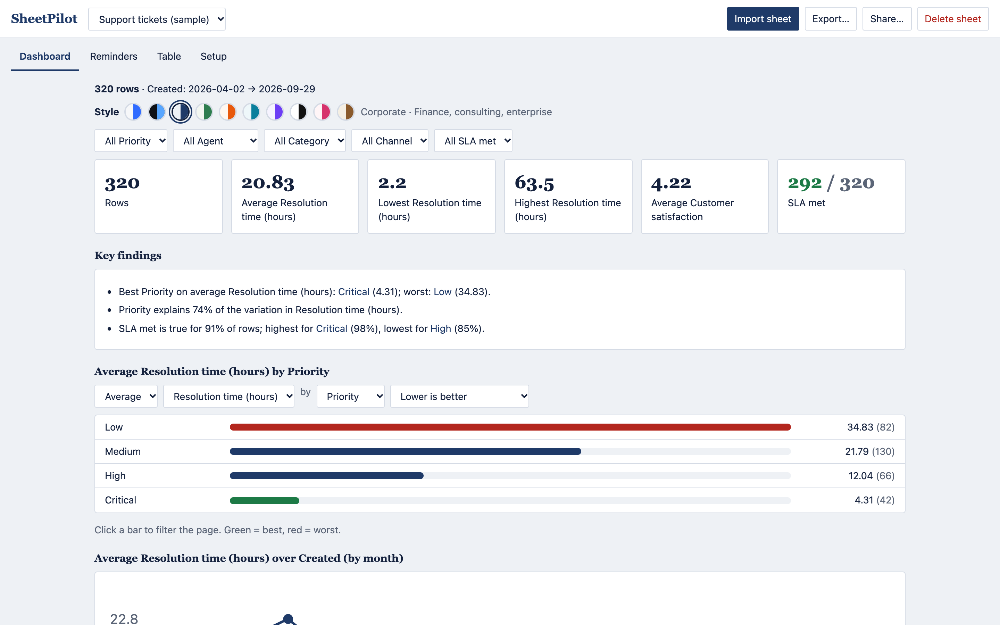
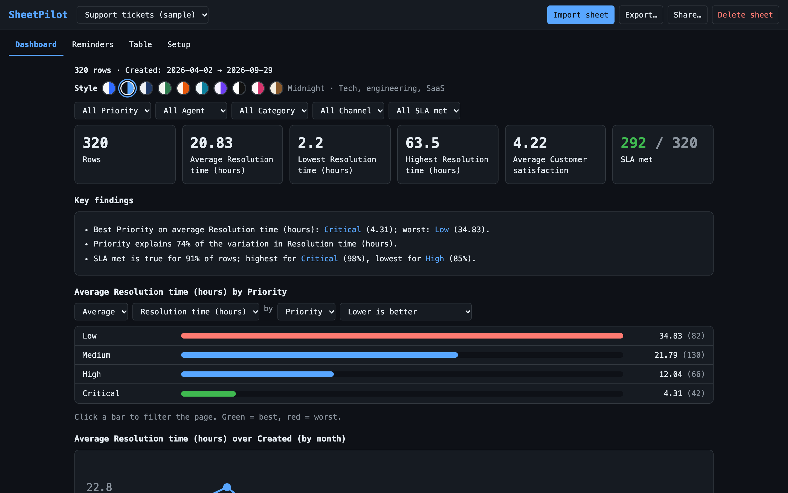

# The dashboard

The dashboard is built from what SheetPilot understood about your sheet. Every section responds to the filters.

## Filter and compare

- Use the **dropdowns** under the style picker to filter by any group column, such as priority or agent.
- **Click a bar** in the comparison chart, or a name in the heatmap or findings, to filter the whole page. Click it again to clear it.
- Above the chart, change **average / total / highest / lowest**, the **measure**, the **grouping** and **which direction is good**. The best group turns green and the worst red, when a direction applies.

## The sections

| Section | What it shows |
|---|---|
| Key numbers | Row count and the main numbers. Yes/no columns show how many are true. |
| Key findings | Plain-language observations. See [How SheetPilot reads your sheet](how-it-reads-your-sheet.md). |
| Comparison chart | The main number by group. Click a bar to filter. |
| Trend over time | Grouped by day, month or year depending on the span. |
| Criteria heatmap | Scored columns by group, green for high and red for low. |
| Distribution | How the main number is spread. |
| Highest or lowest rows | The rows that need attention, based on the direction that is good. |
| How the sheet works | The understood structure, formulas and data checks. |

## Choose a style

The **Style** row above the filters has ten styles. Pick one and the whole dashboard, and everything you export or share, uses it.

| Style | Suits |
|---|---|
| Clean | General business; follows your light or dark setting |
| Midnight | Tech, engineering, SaaS |
| Corporate | Finance, consulting, enterprise |
| Forest | Health, sustainability, agriculture |
| Sunset | Retail, hospitality, marketing |
| Ocean | Logistics, travel, utilities |
| Violet | Agencies, creative, media |
| Mono | Legal, editorial, print-friendly |
| Rose | Beauty, lifestyle, non-profit |
| Paper | Education, publishing, HR |

The choice is saved per sheet, and new sheets start with the last style you used.

Next: [Export and share](export-and-share.md).
