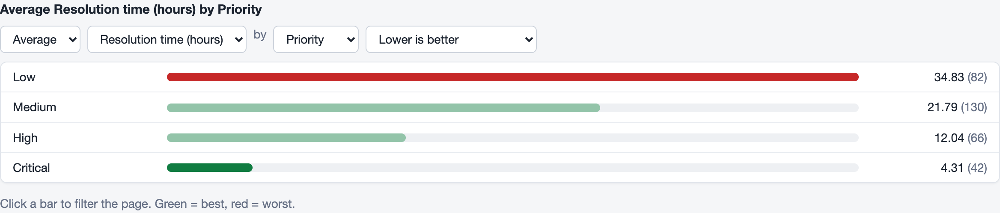
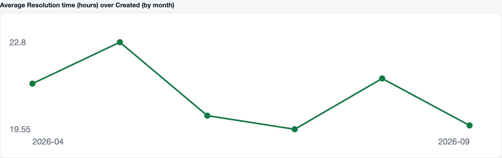
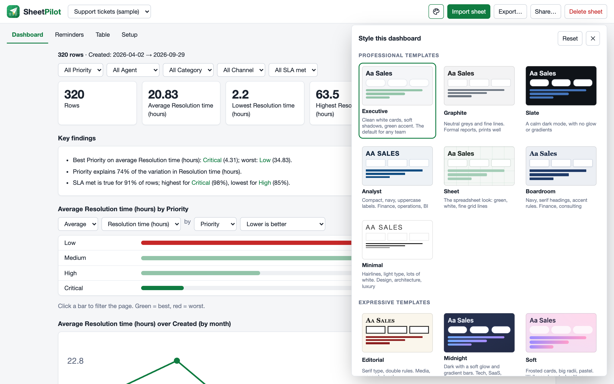
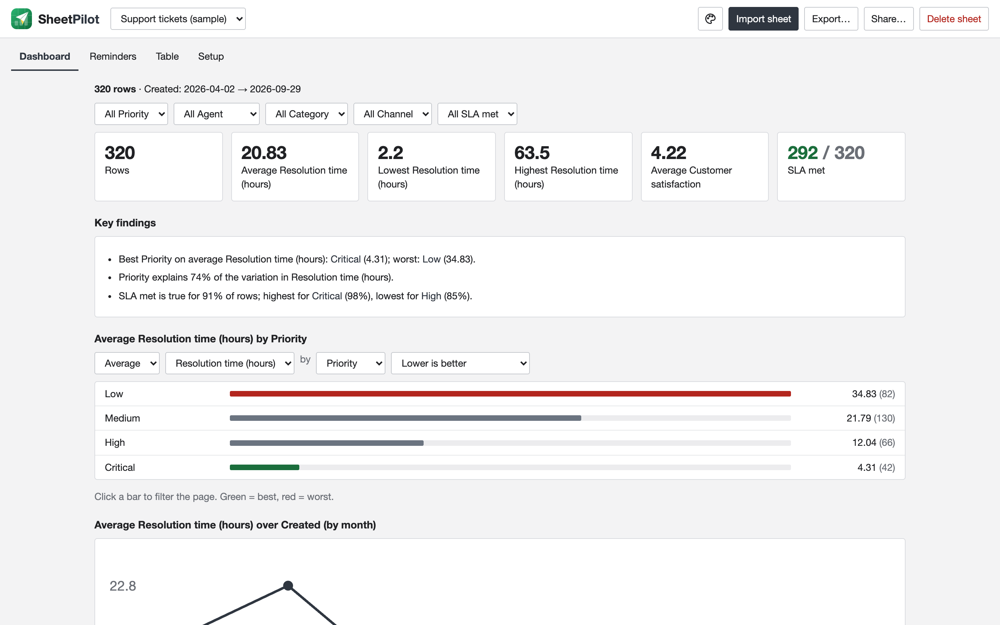
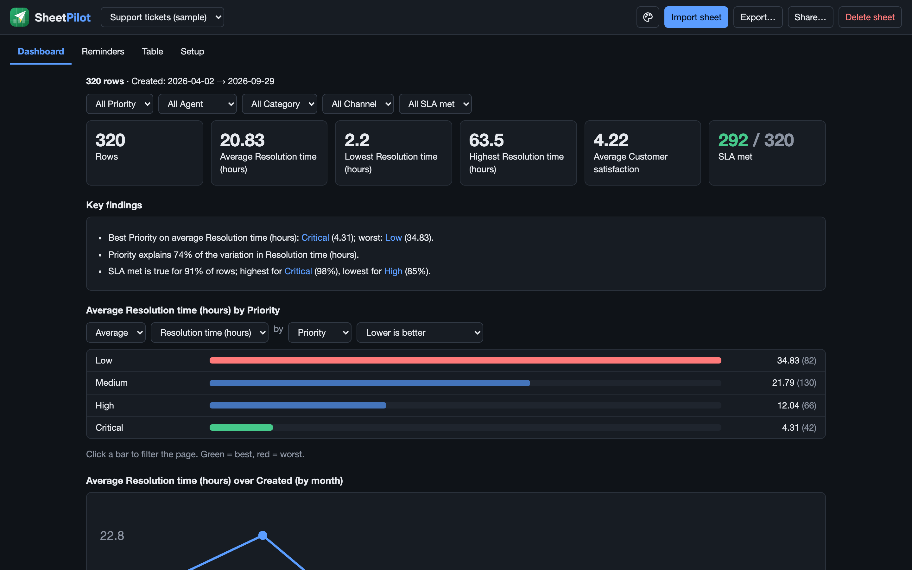
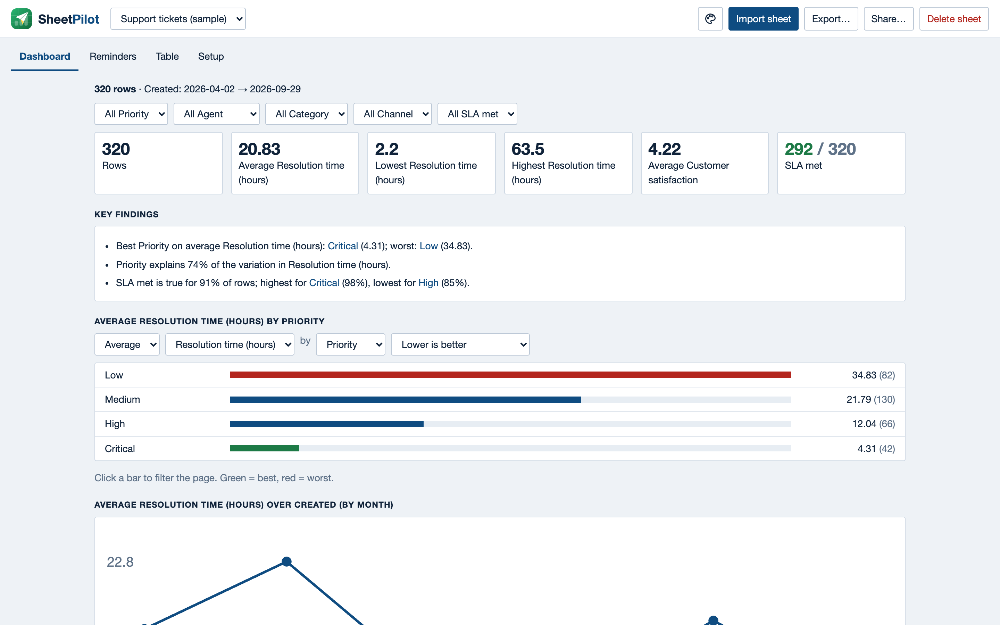
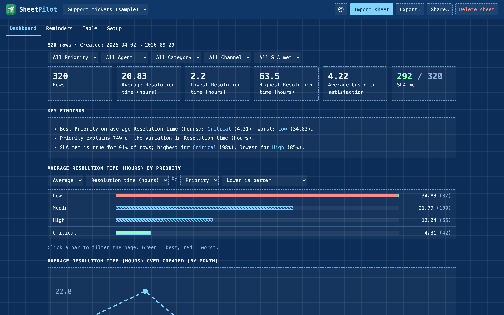
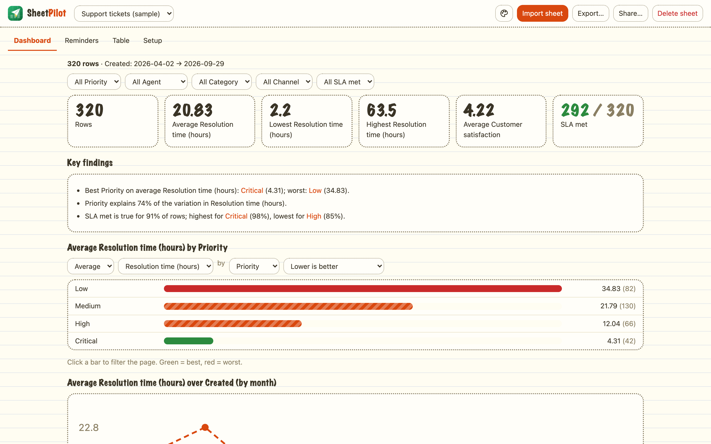

# The dashboard

The dashboard is built from what SheetPilot understood about your sheet. Every section responds to the filters.

## Filter and compare

- Use the **dropdowns** under the style picker to filter by any group column, such as priority or agent.
- **Click a bar** in the comparison chart, or a name in the heatmap or findings, to filter the whole page. Click it again to clear it.
- Above the chart, change **average / total / highest / lowest**, the **measure**, the **grouping** and **which direction is good**. The best group turns green and the worst red, when a direction applies.

## The sections

| Section | What it shows |
|---|---|
| Key numbers | Row count and the main numbers. Yes/no columns show how many are true. |
| Key findings | Plain-language observations. See [How SheetPilot reads your sheet](how-it-reads-your-sheet.md). |
| Comparison chart | The main number by group. Click a bar to filter. |
| Trend over time | Grouped by day, month or year depending on the span. |
| Criteria heatmap | Scored columns by group, green for high and red for low. |
| Distribution | How the main number is spread. |
| Highest or lowest rows | The rows that need attention, based on the direction that is good. |
| How the sheet works | The understood structure, formulas and data checks. |

## Style it: template, font and colour

Click the **palette icon** in the top bar. The panel has three parts, and every change applies straight away:

- **Template**: fourteen looks that differ in more than colour. They change the typography, the outlines (solid, dotted, dashed or double), shadows, spacing and the shape of the charts. The professional ones come first and have no background patterns.
- **Font**: keep the template's own, or switch to Sans, Serif, Mono, Rounded, Humanist or Slab.
- **Accent colour**: keep the template's, or pick one of eight colours.

### Professional templates

| Template | Look | Suits |
|---|---|---|
| Executive | Clean white cards, soft shadows, green accent. The default | Any team |
| Graphite | Neutral greys and fine lines | Formal reports; prints well |
| Slate | A calm dark mode, with no glow or gradients | Screens, dim rooms, dashboards on a wall |
| Analyst | Compact, navy, uppercase labels | Finance, operations, BI |
| Sheet | Green and white with fine grid lines, like a spreadsheet | Spreadsheet fans |
| Boardroom | Navy, serif headings, accent rules | Finance, consulting |
| Minimal | Hairlines, light uppercase type, lots of white | Design, architecture, luxury |

### Expressive templates

| Template | Look | Suits |
|---|---|---|
| Editorial | Serif type, double rules, small caps | Media, research, legal |
| Midnight | Dark with a soft glow and gradient bars | Tech, SaaS, product |
| Soft | Frosted cards, big radii, pastel gradients | Wellness, beauty, healthcare |
| Blueprint | Dashed outlines, mono type, graph paper | Engineering, construction, IT |
| Notebook | Dotted outlines, ruled paper, handwritten headings | Education, small teams |
| Playful | Thick outlines, hard shadows, big bars | Retail, startups, marketing |
| Terminal | Green on black, mono, dashed | Developers, security, ops |

The choice is saved per sheet, new sheets start with the last one you used, and your exports and share links keep it. **Reset** in the panel returns to the default look.

Next: [Export and share](export-and-share.md).
